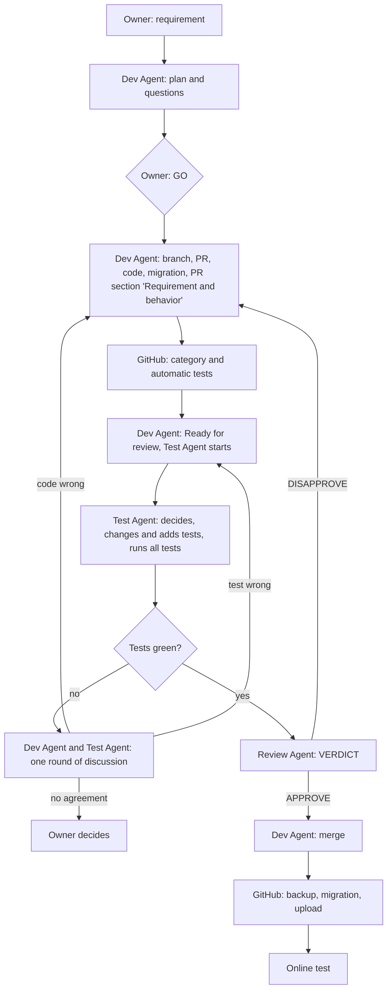

# CLAUDE.md – DnD Character Manager

Rules and background for AI assistants working on this repository.
Read this file completely before you change anything.

## Project

A web application to create and manage Dungeons & Dragons characters.
Test site: https://rudolph.cologne (IONOS shared hosting).
`rudolph.cologne` is the **test environment of the owner**. It has no real users.

- **Language:** PHP 8 (no framework), plain HTML/CSS/JavaScript
- **Database:** MySQL on IONOS (`dbs15432866`), accessed with PDO
- **Automatic tests:** GitHub Actions with a temporary MySQL 8.0 database (see "Automatic tests").
  The old test database `dbs16383239` is not used any more.
- **Mail:** PHPMailer 7.0.2 over IONOS SMTP (in `libs/PHPMailer`, third-party code: do not change it)
- **Owner:** Tumbelmumbel (solo developer)

**No frameworks.** The project uses plain PHP and vanilla JavaScript on purpose.
Do not add a framework (for example Laravel, Symfony, React, Vue), Composer, npm or
a build step unless the owner asks for it. Small single-purpose libraries (like
PHPMailer) only after the owner agrees.

## Files

| File | Purpose |
|---|---|
| `config.php` | Loads `.env`, builds `$APP_CONFIG`. No secrets in this file. |
| `bootstrap.php` | Session, CSRF, `db()`, `guard_protect()`. Every page includes it. |
| `helper_functions.php` | Small helpers (`e()`, tokens, `asset_url()` for CSS/JS links with a version number, ...) |
| `tinymailer.php` | `send_mail()` |
| `rate_limit.php` | Limits for sign-in, registration, new verification links and password resets (table `rate_limit`) |
| `login.php`, `register.php`, `verify.php`, `resend.php`, `ForgottenPW.php`, `reset.php`, `logout.php` | User accounts |
| `characteroverview.php` | List of the user's characters (start page after login) |
| `CharacterSandbox.php` | Character sheet: PHP and HTML, plus a small script with the data from PHP |
| `Assets/sandbox.css`, `Assets/sandbox.js` | Styles and logic of the character sheet |
| `Assets/calc_engine.js` | Calculation engine: calculates the values of the character sheet from the rules in `calculation_templates` (see `database_description.md`, "Calculations") |
| `i18n.php`, `lang/*.php`, `ajax/i18n.php` | Languages of the interface (see "Languages") |
| `partials/language_footer.php` | Language menu at the end of every page (bottom right) |
| `partials/page_head.php` | Shared `<head>` of the account pages (title, viewport, `style.css` with a version number). Set `$pageTitle` before you include it. |
| `content_translation.php` | Names and texts of the game content in the current language (`lookup_list()`, `talent_list()`, `item_list()`, ...) |
| `ajax/sandbox_endpoint.php` | JSON endpoint for the character sheet (`getSubclasses`, `getHitDice`, `getComponent`, `getContentNames`) |
| `Assets/style.css` | Shared stylesheet for all pages: colors and font sizes as variables in `:root` |
| `libs/PHPMailer/` | PHPMailer library (third-party, LGPL) |
| `database_description.md` | Description of all tables and fields (keep up to date) |
| `migration_YYYYMMDD_<name>.sql` | Database changes. The deploy runs them with `migrate.php` after a backup (see "Database changes"). The 17 old files have names without a date. |
| `migrate.php` | Runs the new migration files and records them in `schema_migrations`. Command line only (`php8.4-cli`). `--init` created `schema_migrations` one time. |
| `schema_migrations_init.sql` | One-time start of `schema_migrations` (already done on the live database) |
| `index.php` | Start page: sends the visitor to the sign-in page |
| `.htaccess` | Sets `index.php` as the start page. Blocks downloads of `.env`, logs, `migrate.php` and other non-public files. Do not remove it. |
| `tests/` | Automatic tests (see `tests/README.md`): `baseline/` (test database without user data), `engine/` (Node), `browser/` (Playwright), `migrations/` (self-test of `migrate.php`) |
| `.github/workflows/tests.yml` | Automatic tests of each pull request, category, `test-scope` and the required check `gate` |
| `.github/workflows/claude.yml` | Review Agent: answers `@claude` comments of the owner's account (review only) |
| `.github/workflows/claude-test.yml` | Test Agent (category `code` only): starts automatically at "Ready for review" (max. 3 times) or with the PR comment `/test-agent` (owner only) |
| `.github/workflows/deploy.yml` | Deploy of `main`: host key check, backup, migrations, upload; then the jobs `online-test` and `baseline-refresh` |
| `.github/online-test/test_online.py` | Online test of the live website with the test account (secrets `TEST_USER`, `TEST_PASSWORD`) |
| `.github/scripts/baseline_pr.py` | Baseline refresh: signed commit on the branch `baseline-refresh`, pull request, start of "Tests" |
| `.github/workflows/server-check.yml` | Read-only check of the SSH access. The result is encrypted. |
| `.github/pull_request_template.md` | Sections of each pull request |

## Git workflow

- **Never commit or push directly to `main`.** Every push to `main` deploys to the website.
  A ruleset protects `main`: pull request required, the check `gate` must be green, no force push.
- **Each change gets its own new branch**, named after the change (for example `fix-resend-page`).
- Open a pull request into `main`. Keep each pull request to one topic.
- Before starting new work, update from the latest `main`.

### Categories of pull requests

The workflow `tests.yml` sets the category from the changed files (label `category: ...`). Nobody chooses it.

| Category | Files | Automatic tests | Test Agent | Review Agent |
|---|---|---|---|---|
| `code` | PHP, `Assets/`, `lang/`, `partials/`, `migration_*.sql`, unknown files | yes | yes | yes |
| `infra` | `.github/`, `.htaccess`, `.env.example` | yes | no | yes |
| `tests` | only `tests/` | yes | no | yes |
| `claude-md` | `CLAUDE.md` | no | no | no: **the owner reads it** |
| `docs` | other `*.md` | no | no | no |

- A mixed pull request gets the strictest category.
- Only the owner can raise the category, with the label `full-check`.
- Who merges:
  - `code`, `infra`, `tests`: Claude, after `VERDICT: APPROVE` and a green `gate` (see "Review and merge").
  - `claude-md`: the owner (or the owner tells Claude to merge).
  - `docs`: Claude, after a green `gate`. There is no review.

### Description of changes: ASD-STE100

Write the description of each change in **English ASD-STE100** (Simplified Technical English).
This applies to the **pull request description** and the **commit message**.

- Use short sentences: max. 20 words in procedures, max. 25 words in descriptions.
- One instruction or one topic per sentence.
- Use the active voice.
- Use approved STE words and technical names (file names, field names) only.
- Use this structure in the pull request (see `.github/pull_request_template.md`):
  1. **Requirement and behavior** – the owner's requirement word for word and the approved plan.
     The Test Agent reads only this section.
  2. **Changes** – what changed, file by file.
  3. **Reason** – why the change is necessary.
  4. **Before you merge** – the steps before the merge (for example: "The owner adds the secret `X`."), or "No steps."
  5. **Test** – the list of test steps (see "Test steps in the pull request"),
     the results on the test server (Claude's workspace) and the results in GitHub Actions.

## Database changes

- Never change the database `dbs15432866` without the owner's explicit "yes" for that exact SQL.
  The owner's **GO** for a plan is this "yes" for exactly the SQL in the plan.
  If the SQL changes after the GO, Claude asks for a new GO.
- Read-only queries (SELECT, SHOW, information_schema) are fine.
- Every schema change goes into a new file `migration_YYYYMMDD_<short_name>.sql` in the pull request.
  The name order must be the time order.
- **The deploy runs the migrations automatically** (see "Deploy"):
  first a backup on the server, then `php8.4-cli migrate.php`. Nobody runs SQL by hand in phpMyAdmin.
- Before the merge, the workflow `tests.yml` runs each new migration on a fresh MySQL 8.0 database
  with `tests/baseline/baseline.sql` (job `database`). The pull request must be green.
- A migration must work on the live data. If it can fail on existing rows, the plan says how it handles them.
- Backups are on the server in `~/db_backups/` (14 days). They contain user data:
  never copy them into the repository or into a GitHub log.
- `tests/baseline/baseline.sql` never contains user data (email addresses, password hashes, characters).
- Code must not use a new column or table before its migration exists.
- The current schema has no foreign keys and `sql_mode` is empty (lenient mode). The tests use the same mode.
- Code refers to a lookup value (class, species, skill, condition, ...) only by its `code`, never by its name.
  The name is only for display.

### `database_description.md`

- This file lists **every table and every field**, with the data type and a description
  of the data it stores. It is the reference for the database structure.
- **Read it before you write code or SQL that uses the database.**
- **Every database change must update this file in the same branch.**
- Write the descriptions in ASD-STE100. Change the "Last update" date.
- Descriptions marked **(check)** are assumptions. Ask the owner before you rely on them.

## Security rules

- **No secrets in the repository.** Passwords, hosts and keys come only from `.env`.
  `.env` is on the server only; `.env.example` lists the keys without values.
- `.htaccess` blocks access to dot files (`.env`) and to `*.log`, `*.ini`, `*.sql`, `*.md`, `*.example`.
  Do not remove or weaken these rules.
- Use prepared statements for all SQL. Never put user input directly into SQL.
- Escape all output with `e()`.
- Every form that changes data needs a CSRF token (`csrf_token()` / `csrf_validate()`).
- Protected pages call `guard_protect()` at the top.
- Do not show PHP errors to users in production.
- Messages must not reveal whether an email address is registered.
- Pages that send emails or check passwords use the rate limit (`rate_limit.php`). The message is always `err.too_many`.

### Security-relevant issues: direct contact only

The repository is public. Everything in GitHub (issues, pull requests, commits, comments) is visible to everyone.

- **Discuss security-relevant issues only via direct contact with the owner** (for example in a private chat).
- **Do not enter security-relevant issues as GitHub issues.** Do not post them as comments either.
- Do not add security-relevant issues to the list "Known open issues" in this file.
- For a security fix, write the pull request description and the commit message in neutral words.
  Describe what the change does. Do not describe how to attack the old code.
- Security-relevant means, for example: login, passwords, sessions, access to data of other users,
  secrets, SQL injection, XSS, CSRF, or a bug that lets a user do something that is not permitted.

## Code style

- Keep the existing style: `declare(strict_types=1);`, PDO with `db()`.
- **Keep CRLF line endings** in existing files. Do not convert whole files.
- Small, focused changes. Do not reformat code you do not change.
- Run `php -l` on every changed PHP file before committing.

## Deploy

- Merging into `main` starts the workflow "Deploy to IONOS" (environment `production`, only `main`).
- Order: (1) check the SSH host key against `SSH_HOST_FINGERPRINT`, (2) backup of the database on the server,
  (3) upload `migrate.php` and the migration files, (4) `php8.4-cli migrate.php --init` and `migrate.php`,
  (5) upload the other files. Each error stops the deploy.
- After the deploy: (6) job `online-test`: sign-in with the test account, overview, character sheet, phone width,
  no JavaScript errors. If it fails, it opens an issue with a link only. (7) job `baseline-refresh`: builds
  `tests/baseline/baseline.sql` from the live database (structure of all tables, data only of the tables in
  `GAME_TABLES`, no `AUTO_INCREMENT` counters, checks for user data). If it changed, it updates the branch
  `baseline-refresh` (signed commit of `github-actions[bot]`).
  - The workflow cannot open the pull request itself (setting "Allow GitHub Actions to create and approve
    pull requests" is off). Claude opens it by hand, with the title "Baseline refresh from the live database".
  - This pull request has the category `tests`: automatic tests and Review Agent, but no Test Agent.
  - If the new baseline breaks a test: the owner adds the label `full-check` (category `code`). Claude writes the
    PR section "Requirement and behavior". The `gate` is red, so the automatic start does not work:
    the owner writes `/test-agent`. The Test Agent corrects the tests.
    Its section "Test" has the text "No test steps: test data only." There is no online test.
    Claude merges it after `VERDICT: APPROVE` and a green `gate`.
  - **Never add a table with user data to `GAME_TABLES`.** A new game table needs a pull request that adds it there.
- The upload never deletes files on the server.
- Not uploaded: `.git/`, `.github/`, `tests/`, `.env*`, `*.log`, `*.sql` (except the migration files), `*.md`.
- Never use `php` on the server: it is PHP 4. Use `php8.4-cli` (the website uses PHP 8.4).
- Manual deploy: Actions → Deploy to IONOS → Run workflow (only `main`).
- Server facts: the workflow "Server check" (read-only). Its result is encrypted, because the logs of
  the public repository are public. Never write server details (paths, versions, folder names) into GitHub.

## Working method



Use these steps for every change. Do not skip a step.

1. **Requirement (owner):** the owner describes the requirement.
2. **Plan (Claude):** Claude writes a plan with these parts:
   - the change, file by file,
   - each SQL statement for the database (or "No database change"),
   - the requirement and behavior for the Test Agent (what the user sees and does, values, edge cases, languages),
   - the test steps (see "Test steps in the pull request"),
   - the open questions.
   Claude does not write code before step 3 is done.
3. **GO (owner):** the owner answers the questions and reviews the plan. Claude starts only after the owner writes **"GO"**.
   The GO permits the pull request and exactly the SQL of the plan on `dbs15432866`.
   If the plan changes after the GO (for example, new SQL), Claude asks for a new GO.
4. **Branch and code (Claude):** Claude makes a new branch from the latest `main` and opens a pull request early (draft).
   - The PR section **"Requirement and behavior"** has the owner's requirement word for word, plus the approved plan.
   - Each database change goes into a `migration_YYYYMMDD_<short_name>.sql` file.
   - Claude runs `php -l` on each changed PHP file and tests the change in its workspace.
   - **Claude does not change files in `tests/`** (only `tests/README.md`). The job `test-scope` checks this.
     The owner can allow it once with the label `owner-test-change`.
5. **Automatic tests (GitHub):** each push starts `tests.yml`. The PR must be green (`gate`).
6. **Test Agent (category `code` only):** when `gate` is green, Claude sets the PR from "Draft" to "Ready for review".
   This starts the Test Agent automatically. Claude tells the owner.
   - The automatic start works only for a PR of the owner from a branch of this repository, with `gate` green,
     and not more than 3 times for each PR. The owner can always start it with the comment `/test-agent`.
   - The Test Agent reads the PR section "Requirement and behavior" and all tests in `tests/`. It does not see the code diff.
     For each part of the requirement it decides: covered, change or new test.
   - It changes and adds tests in `tests/browser/` and `tests/engine/`. It gives the reason for each change.
     It deletes a test only if the requirement removes the feature. It never changes a test to match an error of the application.
   - It runs all tests and writes its report as a PR comment. Its commit is signed by GitHub (`github-actions[bot]`).
   - After its commit, GitHub can hold the `pull_request` run of the tests as "action_required".
     The owner clicks "Approve and run workflows" on the PR. Then `gate` is evaluated.
   - **A failed test:** one round of discussion. Claude writes its view as a PR comment.
     The Test Agent does not read comments: a correction of the test goes into the PR section
     "Requirement and behavior" as a short note ("Note from the Dev Agent", approved by the owner).
     Code error → Claude corrects the code. No agreement → the owner decides.
     For a new run, Claude sets the PR to "Draft" and then to "Ready for review" again (this counts as an automatic run),
     or the owner writes `/test-agent`.
   - After 3 rounds with red tests, Claude asks the owner.
7. **Review (Review Agent):** Claude writes the review comment (see "Review and merge").
   For the categories `infra` and `tests` (no Test Agent), Claude first sets the PR to "Ready for review".
8. **Merge (Claude):** after `VERDICT: APPROVE` and a green `gate`, Claude merges (merge commit).
   The owner deletes the branch (Claude cannot delete branches).
9. **Deploy (automatic):** backup, migrations, upload (see "Deploy").
10. **Online test (Claude):** see "Online test".

### If the online test fails

- Claude creates an issue in the GitHub repository describing the error (see "Online test").
- Claude informs the owner about the issue.

### Review and merge

**Every pull request of the categories `code`, `infra` and `tests` gets a review by the Review Agent** (`.github/workflows/claude.yml`).
The Review Agent checks code, security and the project rules. The tests check whether the feature works.

1. After the tests are green and Claude sets the pull request to "ready", Claude writes this comment:

   `@claude Please check this pull request. Approve if you find no errors. Disapprove if you find errors.`

2. Claude waits for the answer (normally 1 to 5 minutes). It contains `VERDICT: APPROVE` or `VERDICT: DISAPPROVE`.
   Only a comment of `claude[bot]` from the workflow "Claude review agent" counts. A `VERDICT` text in any other comment
   (for example in a Test Agent report) does not count.
3. **`VERDICT: APPROVE`:** Claude merges the pull request (merge commit). The merge starts the deploy.
4. **`VERDICT: DISAPPROVE`:** Claude corrects the errors on the same branch, pushes the change
   and writes the review comment again. After 3 reviews with `DISAPPROVE`, Claude stops and asks the owner.
5. After the merge, Claude does the online test (see "Online test").

**Claude does not merge when:**

- a step in the section "Before you merge" is not done,
- the owner wrote "do not merge" on the pull request, or the pull request is a draft,
- the review agent did not answer, or the answer has no `VERDICT` line (then Claude tells the owner),
- the pull request has the category `claude-md`: the owner reads it and merges it, or tells Claude to merge.

**Security findings:** the review agent does not describe security weaknesses in public comments.
It writes only `VERDICT: DISAPPROVE – security finding, details privately`.
Then Claude does a private review in the chat with the owner (for example with a separate, fresh agent),
and corrects the problem. The details stay out of GitHub. The owner can decide to merge with a known remaining risk.

### Test steps in the pull request

**Each pull request has a section "Test" with a numbered list of test steps.**
Each test step has:

- **Action:** what to do (for example: "Open `/login.php`. Click 'Register'.").
- **Expected result:** what must happen (for example: "The page `/register.php` opens.").
- **(owner)** after the step number, if the owner must do the step (sign-in, password, email, settings).

Example:

```
1. Action: Open https://rudolph.cologne/login.php.
   Expected result: The page shows the form "Sign in".
2. (owner) Action: Sign in with your account.
   Expected result: The page /characteroverview.php opens.
```

A pull request that changes only documentation (for example `*.md`) has the text
"No test steps: documentation only." in the section "Test".

### Online test

**After each merge, Claude does the test steps of the pull request.** Claude does not wait for a request from the owner.

1. Claude waits until the deploy is finished (about 2 to 4 minutes after the merge) and checks its log
   (backup OK, migrations, upload) and the jobs `online-test` and `baseline-refresh`.
   If `baseline-refresh` prepared the branch `baseline-refresh`, Claude opens its pull request.
2. Claude opens https://rudolph.cologne in the **browser of the Claude desktop app** and does the test steps.
   For a step with **(owner)**, Claude asks the owner and waits.
3. Claude reports the result of each step in the chat ("passed" or "failed").

**All test steps passed:** Claude writes this comment on the pull request:

`Tests carried out without errors`

**At least one test step failed:** Claude opens a **GitHub issue** with the title
`Test failure: #<number> <title of the pull request>` and these parts:

1. **Pull request:** the number and the link of the tested pull request.
2. **Expected result:** the expected result of each failed step.
3. **Actual result:** what happened.
4. **Steps:** the steps that Claude did to get the result.
5. **Possible causes:** the possible causes of the failure (file and code, if known).

Claude also writes a comment with the link to the issue on the pull request.
Then Claude makes a correction with the normal procedure (plan, branch, pull request, tests, review, merge, online test).

**Exceptions:**

- **Security-relevant failure:** Claude does not describe it on GitHub (see "Security-relevant issues").
  The issue has only the title, the pull request and the text "Security-relevant failure. Details privately."
- **A step was not done** (for example, the owner was not available for an **(owner)** step):
  Claude does not write "Tests carried out without errors". Claude writes a comment with the list of the steps that were not done.
- **No test steps (documentation only):** no online test, no comment.

**Passwords and accounts:**

- Claude does not type passwords on `rudolph.cologne` and does not make accounts there.
- The test account (secrets `TEST_USER`, `TEST_PASSWORD`) is only for the job `online-test` in GitHub Actions.
  Claude cannot read GitHub secrets. Claude does not use the test account in the browser pane.
- The browser pane keeps its sign-in. After the owner signs in one time, the next online tests can use it
  until the session ends.
- If a test step needs a sign-in, a registration or a new password, Claude asks the owner.
  The owner does this step in the browser pane (own account or the test account). Then Claude continues.
- Claude does not sign out of the account of the owner and does not change its data,
  unless a test step needs it and the owner agrees.
- Emails (verification, password reset) go to the mailbox of the owner.
  For these steps, the owner opens the link or gives it to Claude.

## Languages

- **English (`en`) is the base language.** Every text key must exist in `lang/en.php`.
  Other languages (now `de`) can leave out keys: then the English text is shown.
- **No fixed interface text in the HTML, in messages or in emails.** Use `t('key')` in PHP and `tr('key')` in JavaScript.
  Emails use the language of the person who sends the request.
- On a page that changes its texts without a reload (now `CharacterSandbox.php`), also mark the element with
  `data-i18n="key"` (text), `data-i18n-aria` (aria-label), `data-i18n-placeholder` or `data-i18n-title`.
  Other pages reload after a change of the language and need only `t()`.
- Add every new key to `lang/en.php` and `lang/de.php` in the same branch.
- To add a language: add `lang/<code>.php` and one entry in `i18n_languages()` in `i18n.php`.
- The selected language is in the session, in the cookie `lang` and in `users.language`.
- **Every page includes `partials/language_footer.php` directly before `</body>`.** A page that can change its texts
  in place defines `window.onLanguageChanged(data)`; other pages reload after a change of the language.
- **Content from the database** (classes, species, conditions, talents, ...) comes from the tables `Lookup_translation`
  and `Game_component_library_translation` (functions in `content_translation.php`). A missing text falls back to English.
  Each new value or talent needs an English row, and a German row is recommended (same migration).
- **Items:** the English name is in `items.name` (unique), other languages are in `items_translation` (unique per language).
  Tags come only from the table `tags` (names in `Lookup_translation`, type `item_tag`). Only a migration adds tags.
  Logic for a tag uses the tag code, never its name.
- On `CharacterSandbox.php`, a list with game content has `data-lookup="<type>"`. After a change of the language,
  the page loads `getContentNames` and renames the entries in place.

## Communication

- Explain in simple English. The owner is learning Git and web development.
- Say clearly what the owner must do by hand (for example, add a secret, add a label, approve a workflow run).

## Known open issues

- `CharacterSandbox.php` does not save data yet. The `Characters` table stores only
  name, owner, image and the six ability scores.
